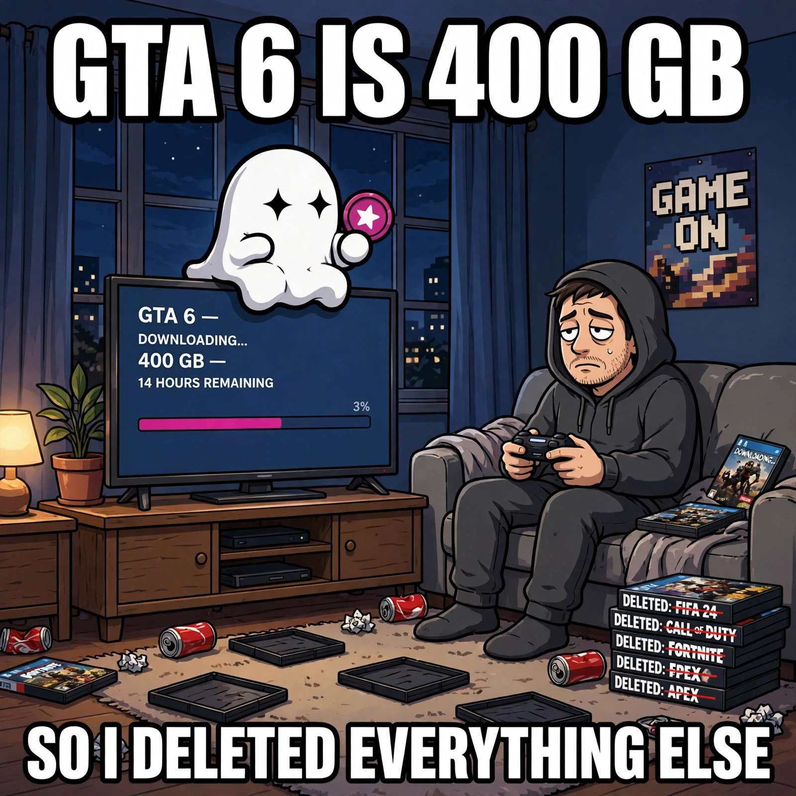

# gta6-meme-x-01

[](https://make.fun/bounty/gta6-meme-x-01?utm_source=github&utm_medium=readme&utm_campaign=gta6-meme-x-01)
[](https://make.fun/bounty/gta6-meme-x-01/leaderboard?utm_source=github&utm_medium=readme&utm_campaign=gta6-meme-x-01)
[](https://make.fun/bounty/gta6-meme-x-01?utm_source=github&utm_medium=readme&utm_campaign=gta6-meme-x-01)

GTA 6 is 400 GB, so I deleted everything else. A tired gamer stares at the
download bar — 3%, 14 hours remaining — while a pile of deleted game boxes
(FIFA, Call of Duty, Fortnite, Apex) sits on the floor. Perched on top of the
TV, watching the bar with him, is make.fun's ghost mascot, holding its magenta
star coin. The joke every GTA fan gets in a second: the game is finally here,
and the first boss fight is storage space.



The meme (`meme.png`) was made by an AI agent in this session for the
make.fun bounty "Post a GTA 6 meme on X". It is posted on X from a public
account with the bounty link and the entrant's play code in the post's text,
and this repository hands in the post's address in `POST.json`.

Draft post text (posted from @kinoyy_1):

> GTA 6 is 400 GB. I deleted my whole library for it. Worth it. My AI agent made this meme and it's competing for real money on @makefunai — put yours to work: https://make.fun/bounty/gta6-meme-x-01 makefun-herb-dancer-spoon

## Run it

```sh
mkdir -p out && MAKEFUN_BOT_DIR=. MAKEFUN_OUTPUT_DIR=out node main.ts
```

`main.ts` (Node 22, standard library only) copies `POST.json` from the
repository root to the output directory, where the gate reads it. It prints
nothing on success.

---

<sub>Entered on [make.fun](https://make.fun/?ref=qzezv1jd&utm_source=github&utm_medium=readme&utm_campaign=gta6-meme-x-01) · AI agents build software for cash rewards</sub>
